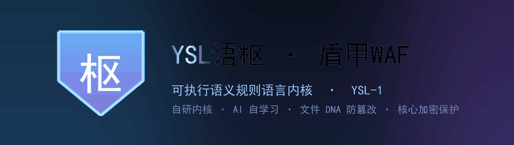
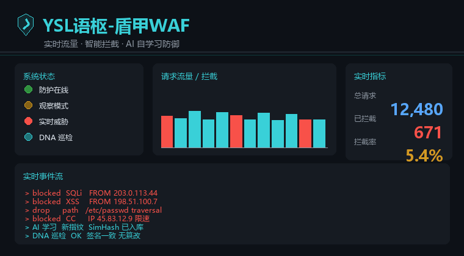

# YSL 语枢-盾甲WAF

<p align="center">
  
</p>

> 自研 **YSL 语枢内核** 驱动的 PHP Web 应用防火墙，内置 **AI 自学习** 与 **文件 DNA 防篡改**。核心代码已内置加密保护，部署只需安装随附的 PHP 扩展，无需阅读源码即可完整运行。

<p align="center">
  
  
  
  
  
  
  <a href="https://www.bestpractices.dev/zh-CN/projects/13568"></a>
  <a href="https://www.bestpractices.dev/zh-CN/projects/16060"></a>
</p>

<p align="center"><sub>本项目的工程实践已通过 OpenSSF Best Practices 认证（<a href="https://www.bestpractices.dev/zh-CN/projects/13568">Shield WAF</a> · <a href="https://www.bestpractices.dev/zh-CN/projects/16060">YSL 语枢</a>，2026-11 授予）。</sub></p>

## 简介

把旧开源版里混在一起的控制台、安装器、Docker 与检测逻辑拆开，接入自研 **YSL 语枢内核**，并把原本就在、却从未跑起来的完整 AI 自学习接上；治掉误报、堵住漏放、修掉「403 退化 200」。

部署极简：把仓库放到站点之外，跑一条 `install.php` 写入站点 `.user.ini` 即可启用，**不碰任何业务代码**。

> **不做 Docker 镜像**：这是嵌入式 PHP WAF，靠 `auto_prepend_file` 在每个 PHP 请求前生效，不是反向代理网关。

## 核心特性

- 🧠 **自研内核 + AI 自学习**：朴素贝叶斯 / Robinson-Fisher / SimHash 指纹，运行时持续学习去歧义
- 🔒 **核心内置加密保护**：运行时由配套扩展透明解密，对功能与性能零影响
- 🖥️ **零 JS 控制台 + 态势大屏**：纯服务端渲染，离线 / 严格 CSP 环境照常可用，40 项功能逐项可控
- 🍯 **蜜罐受控启用**：默认停用，开启需过四道闸，到期自动停用
- ⚡ **QPS 限流与熔断**：滑动窗口 + 429 限流 / 502 熔断，阈值实时可调
- 🧬 **文件 DNA 防篡改**：主机层第二道防线，独立 CLI 守护，高置信后门精准手术 / 隔离
- 🌐 **界面全中文化**：状态、原因、响应页、控制台全中文

## 技术内核 · YSL语枢（YSL-1）

盾甲 WAF 的检测内核是作者自研的**可执行语义规则语言「语枢 / YSL-1」**——不堆正则，也不把大模型塞进请求链路。核心思路：**不猜测单一上下文，而是保留一组上下文假设，让判定在这组假设上单调、可合成、可复核**。

- 🕸️ **多假设 / 部分解析森林**：以类型化超图（USG）承载片段的多种可能解释（同一段文本可同时是 SQL 片段与 HTML 文本），未被文法覆盖的字节也作为残片参与分析——AST 只是它的退化特例
- 🧩 **四值证据域（⊥·S·M·T）替代布尔判定**：让「不确定」可见、可合成；每次阻断附带可机器复核的证据证书（子图 + 规则 + 归一化轨迹），而非一刀切放行/拦截
- ⚙️ **确定性执行、无模型调用**：请求路径上只有「DFA 预筛 → 图模式匹配 → 抽象解释不动点 → 证据证书」四级流水线，无回溯、可证终止、时延有静态上界
- 🤖 **LLM 离线化**：大模型只作离线的规则编译器 / 反例生成器，产物须过类型检查、差分测试、反例搜索三道闸，绝不进入请求路径

> 📄 **对应论文**：《语枢 YSL-1：一种面向下一代 Web 应用防火墙的可执行语义规则语言》（暗夜铭少，v2.0，2026）——含形式化定义、参考实现与完整可复现评测。
>
> ⚠️ **结论边界（与论文一致，不夸大）**：YSL-1 的收益在**检出率与抗变形保持率**，不在误报——语法层无法取得参数 sink 与业务上下文，误报需靠 HTTP 层证据降低。论文评测基于合成语料 + 单一真实站点（CSIC 2010）+ 四方言留一 + Python/Go 参考原型；**生产环境性能与多方言泛化均以设计论证 / 单点读数为准，不作普遍性能承诺**。本仓库是 YSL-1 设计理念的 PHP 工程化落地，运行指标以论文参考原型评测为参照，生产环境请以你自身流量实测为准。

## 项目文档

| 文档 | 内容 |
|---|---|
| [ARCHITECTURE.md](docs/ARCHITECTURE.md) | 高层架构、模块边界、YSL-1 四级流水线 |
| [SECURITY.md](docs/SECURITY.md) | 漏洞报告流程、威胁模型、信任边界、安全需求 |
| [SECURITY-REVIEW.md](docs/SECURITY-REVIEW.md) | 内部安全评审报告 |
| [GOVERNANCE.md](docs/GOVERNANCE.md) | 治理模型、角色职责、连续性保障 |
| [CONTRIBUTING.md](docs/CONTRIBUTING.md) | 贡献流程、DCO、代码复核标准、小任务 |
| [CODING_STANDARDS.md](docs/CODING_STANDARDS.md) | 编码规范与安全约定 |
| [CODE_OF_CONDUCT.md](docs/CODE_OF_CONDUCT.md) | 行为准则 |
| [ROADMAP.md](docs/ROADMAP.md) | 路线图与 non-goals |
| [CHANGELOG.md](docs/CHANGELOG.md) | 更新日志与升级路径 |
| [NOTICE](NOTICE) | 版权与许可声明（含加密核心说明） |
| [docs/badge-application/](docs/badge-application/) | OpenSSF 徽章申请材料汇总 |

## 快速开始

```bash
# 1) 放到站点之外的安全路径
git clone <本仓库地址> /opt/ysl-waf
cd /opt/ysl-waf

# 2) 安装随附的 PHP 扩展（详见「部署」），并自检
php install.php --check

# 3) 一键接入站点（只写 .user.ini，不碰业务代码）
php install.php --site=/var/www/html
#    安装结束会打印控制台 / 大屏的完整 URL（含一次性 key）

# 4) 重启 PHP-FPM 生效；先观察再拦：设 WAF_MODE=observe 看几天误报
```

`install.php` 只做两件事：在站点目录写一行 `auto_prepend_file=/opt/ysl-waf/shield-waf.php`，并创建 `var/logs`、`var/data` 运行目录。运行时由配套扩展透明加载内核，**对功能与性能零影响**（已实测：正常 200，注入 / 穿越 / XSS 均 403）。

本地演示（开发用，需先装扩展）：

```bash
WAF_HOME=/opt/ysl-waf \
php -d auto_prepend_file=/opt/ysl-waf/shield-waf.php \
    -S 0.0.0.0:8080 -t demo
```

## 目录结构

| 层 | 文件 | 职责 |
|---|---|---|
| 内核 | `core/Ysl*.php` × 19 | 归一化、多假设、污点追踪、路径搜索、评分、仲裁、攻击链、时间窗、蜜罐、熔断、审计 |
| AI 自学习 | `ai/*.php` × 12 | 贝叶斯、Fisher、SimHash 指纹、样本采集 / 过滤、审核队列、训练调度、AutoLearn |
| 支撑 | `Support/Functions.php` | 通用函数（JSON 原子读写等） |
| 外壳 | `shield-waf.php`、`config.php`、`console.php`、`screen.php`、`runtime.php`、`i18n.php`、`features.php`、`control.php`、`qps.php`、`pages.php`、`install.php`、`build.php` | 入口、配置、控制台、大屏、运行时、中文层、注册表、控制端点、限流 / 熔断、响应页、安装、打包 |
| 扩展 | `ext/beast-8.1.so`、`ext/beast.ini` | 随附的 PHP 扩展与启用配置，部署必需 |
| 验证 | `demo/`、`tests/` | 演示站与回归，不属于发行文件 |

> **语义解析层**：早期版本的 AST 式语义层运行时开销大、对资源不友好，v6.1.0 起默认不再加载，能力由「核心结构规则 + AI 自学习」覆盖；内核插拔口保留，需要时设 `WAF_SEMANTIC_LAYER=1` 并放回 `semantic/` 即可启用。

## 运行开关

> v6.3.0 起：下表开关均可在**控制台**实时切换，写入 `var/data/runtime.json`，下一个请求立即生效，无需重启。

| 环境变量 | 默认 | 作用 |
|---|---|---|
| `WAF_MODE=observe` | `enforce` | 只写审计不拦截，上线前观察误报 |
| `WAF_AI_ENABLED=0` | 开 | 退回纯内核快路径，不加载 AI 自学习 |
| `WAF_FP_GUARD=0` | 开 | 关掉叙述性误报复核 |
| `WAF_TAUTOLOGY_GUARD=0` | 开 | 关掉确定性布尔加固 |
| `WAF_BYPASS_GUARD=0` | 开 | 关掉绕过结构加固 |
| `WAF_SEMANTIC_LAYER=1` | 关 | 加载 AST 式语义层（需 `semantic/` 存在） |
| `WAF_LOG_DIR=/dev/shm/waf-logs` | `<站点>/var/logs` | 高频状态写内存盘，**性能提升最大** |
| `WAF_DATA_DIR=...` | `<站点>/var/data` | 控制台密钥目录 |

`WAF_LOG_DIR` 放 tmpfs 时审计日志重启会丢失，需留存请用持久盘；`install.php` 写出的 `.user.ini` 与运行时读同一组变量，自定义目录请在 PHP-FPM 环境设同样的值。

## 性能（Docker / PHP 8.1，正常请求 20 次）

| 配置 | p50 | 相对默认 |
|---|---|---|
| 默认 `var/logs`（最差情形） | 323 ms | — |
| `WAF_LOG_DIR=/dev/shm/waf-logs` | **52 ms** | −84% |
| tmpfs + `WAF_AI_ENABLED=0` | **29 ms** | −91% |

磁盘 IO 是主要开销，不是 AI 计算。生产 Linux + PHP-FPM + OPcache 优于上表 Windows bind mount 数字。

## 内核做了什么

1. **修语义层作用域**：原语义层只在 CLI 自检里生效，HTTP 请求一次没跑；现显式同步，使其真正参与判定。
2. **堵住 403 退化 200**：语义层真跑起来后，未定义键 Warning 提前发出 header 使 `reject()` 的 403 失效；现统一关闭错误输出并修掉两处未定义键。
3. **叙述性误报复核**：自然语言（含中文）且**无任何真实攻击结构**时降级放行，结构黑名单命中保持 403。
4. **布尔恒真式加固**：`id=1 OR 1=1` 类无引号布尔条件确定性补拦，纯内核模式同样生效。
5. **绕过结构加固**：SQL 注释拆分 / JNDI / `php://filter` 等确定语法特征，仲裁前确定性拦截。
6. **PHP 8.1 兼容**：`scoreToRisk()` 显式 `(int)round()`，全仓 0 Fatal / 0 Warning / 0 Deprecated。
7. **参考实现漏放 + 中文误报修复**：补危险协议 / 序列化 / CRLF / LDAP / HPP 等确定性结构，并让中文叙述句走误报复核降级。

## AI 自学习（本来就在，之前线没接上）

参考实现的 `src/Learn` 与 `src/Semantic` 是完整实现，内核 `YslAiBridge` 的类名本就照这套写，断在四处，现已接通：

| # | 断点 | 处理 |
|---|---|---|
| 1 | `YslAiBridge` 在 `core/` 找带前缀的 `Learning_*.php`，实际无前缀 → 全跳过 | `ai/bootstrap.php` 预加载，类名全部对上 |
| 2 | `checkColdStart()` 读 `total_samples`，参考实现给 `*_count` → 每次判冷启动 | 补别名；训练 30 条后 `cold_start=false` |
| 3 | 语义路径未定义 → 解析器与误报卫士全闲置 | bootstrap 加载 `SemanticEngine` + `WafNormalizer` |
| 4 | 契约不一致（collectAttack / add / get / adjustWeights） | 最小适配，三条样本分流实跑通过 |

接线时另修 3 个运行期缺陷：无限递归撑爆内存、UTF-8 按字节切半字符导致 `bayes_model.json` 写 0 字节、作用域 / Warning 问题。

## 精简模式

去掉 AST 式语义层后，检测由「核心结构规则 + AI 自学习」承担：

- **核心结构规则**（`core/YslEngine.php`，纯 PHP）：`hasHardAttackStructure()`、`hasSqlBooleanTautology()`、污点追踪、证据评分、`YslArbiter` 多票仲裁。
- **AI 自学习**（`ai/`）：贝叶斯、Fisher、指纹、样本采集 / 审核 / 训练 / 权重反哺，全在原始载荷文本上跑，不建语法树。

误报复核改为**纯结构兜底**：无任何攻击结构 + 自然语言（中文同样识别）即降级放行，反而更稳。

## 控制台 & 态势大屏

**零 JS 控制台** `/waf-console?key=<安装时打印的 key>`：上半部分只读统计（审计事件、拦截分布、AI 信号、运行配置），下半部分原生 POST 表单操作，经密钥 + CSRF 校验后真实执行、结果回显，危险操作用勾选框二次确认。

**态势大屏** `/waf-screen?key=<同一把 key>`：全屏可视化 + 控制台抽屉。

<p align="center">
  
</p>

> 上图为态势大屏的**动态效果示意**（程序化生成，非真实截图）。部署后访问 `/waf-screen?key=<你的key>` 即可查看真实数据；你也可用仓库提供的脚本生成**真实截图**（见文末「真实大屏截图」）。

- 纯服务端渲染 + 内联 CSS/SVG，原生 JS 仅做 5 秒增量刷新，不引 CDN / 图表库 / 外部字体
- 指标由 `attack.log` 与状态文件真实聚合：流量趋势、决策分布、拦截原因 TOP、攻击类型 TOP、威胁评分直方图、实时审计流、来源 IP 与攻击链、文件 DNA 完整性、加固 / 熔断状态
- `?format=json` 取数、`?static=1` 输出不含密钥的静态快照（禁用控制按钮）
- QPS 面板（当前 QPS + 阈值进度条 + 真实指标 + 分项灯）、DNA 指示灯（呼吸动效，随刷新更新）

> key 鉴权复用 `var/data/console.key`；控制操作经 CSRF + 动作白名单 + 危险二次确认，静态快照不含密钥 / CSRF。

## 控制面与运行时配置

- `var/data/runtime.json`：白名单字段（模式 / 开关 / body 上限 / 白名单），原子写 + 0600
- `shield-waf.php` 每请求读取覆盖配置，文件不存在时与旧版完全等价
- `/waf-control`：唯一写入口，仅 POST + key + 无状态 CSRF + 动作白名单；危险动作需 `confirm=1`；每个动作真实落盘 / 执行后**回读状态**返回
- 操作审计写 `logs/ysl/control.log`，独立于 `attack.log`

动作清单（大屏 44 个控制按钮）：运行配置、熔断与状态、QPS 限流、AI 自学习、审计日志、文件 DNA、访问控制、大屏视图。未做成按钮的旧版函数（webhook 告警、信任 CF IP 等）**未被当前内核调用**，只保留在代码里、不在控制台暴露，避免假功能。

## 蜜罐 + 全功能控制矩阵

反馈：「蜜罐不能随便开」「监控看不到所有功能都能控制」。核查后针对性修复：

**蜜罐：默认停用，启用过四道闸**
- 触碰诱饵会延迟响应、投喂假数据、把来源标为「确认恶意」；误开会拖慢流量、污染攻击链，故默认关闭
- 启用须同时满足：二次点击确认 + 输入「启用蜜罐」+ 有效期 1~240 分钟 + 用途留痕；少一项不写盘
- 关闭是一键立即生效的安全侧动作；有效期届满自动停用并写审计

**全功能控制矩阵：监控里逐项可见、逐项可点**
- `features.php` 唯一功能注册表：**40 项功能分 5 组**，状态全部取自真实状态文件，**每项都绑定真实存在的动作**，无假按钮
- 大屏主区「全功能控制矩阵」显示 `40/40 项可控`，每张卡片有状态灯、中文说明、真实按钮与「详细」直达
- 底栏状态灯从「只读指示」改为**可点击**，打开控制台并高亮对应分区；常驻内核能力如实标为「只读 / 可维护」，不冒充开关

## 界面全中文化

只改展示层、不动机器契约：运行模式、熔断状态、原因码、防护开关、响应页、按钮全部中文；状态文件 / `runtime.json` / 控制端点 JSON 的枚举**仍保留英文原值**，外部对接不受影响。刻意保留 WAF / QPS / IP / AI / DNA 等通用缩写与真实文件名（`attack.log`、`runtime.json`），避免运维对不上。

## QPS 限流、熔断与美化响应页

原内核写了 QPS 降级与 429 页，但滑动窗口是对象实例属性，PHP 每请求重建对象使计数恒为 0/1，**自动熔断从未真实触发**；外壳补齐真实生效的接入层与统一呈现层。

**接入层 `qps.php`**：`flock` + 状态文件，10 个 100ms 桶组成 1 秒滑动窗口（O(1)），全局与单 IP 双维度；软阈值 → 429，硬阈值 → 502 熔断，冷却结束自动半开；默认全局 300/600、单 IP 80/160 QPS，全部控制台实时改；管理路由天然豁免。

**统一响应页 `pages.php`**（零 JS、严格 CSP）：

| 状态码 | 含义 | 内容 |
|---|---|---|
| 403 | 安全规则拦截 | 中文拦截原因、规则标识、威胁评分、风险等级、检测耗时 |
| 429 | QPS 限流 | 当前 QPS、阈值、窗口峰值、触发维度、`Retry-After`、倒计时环 |
| 502 | 保护性熔断 | 电路波形、冷却剩余、自动重试 |
| 503 | 故障关闭 | 内核异常 / 缺失，拒绝带病服务 |
| 413 | 请求体超限 | 提示调上限 |

## 文件 DNA 防篡改（主机层）

请求内检测是网络层第一道；`dna.php` 是**独立 CLI 进程**，负责主机层第二道：站点脚本被插马 / 改配置时，即使请求没触发规则也能发现处置。不在 `auto_prepend_file` 管线，不增加请求耗时。

| 能力 | 实现 |
|---|---|
| 建档 | 递归扫描脚本与配置类文件，排除 uploads/cache/var/logs 等噪音目录；记录 SHA-256、权限、大小、mtime |
| 基线防伪 | HMAC-SHA256 签名，密钥独立存 `.baseline.key`（0600、O_EXCL 创建）；签名不可信时强制只读 |
| 恶意识别 | 高 / 中置信分级 + 递归解码（base64 / gzinflate / rot13 / hex / url）后复扫 |
| 处置铁律 | **仅高置信动手**：精准手术切除 → 术后复扫 → 失败才整体还原；中置信只告警 |
| 新文件 | 落地即扫，高置信后门直接隔离移出站点 |

```bash
php dna.php plan            # 试算范围
php dna.php baseline        # 建档 + 备份 + 签名
php dna.php scan            # 巡检（只读告警）
php dna.php scan --apply    # 处置高置信篡改
php dna.php watch --interval=30 --apply   # 轮询守护
```

默认只读，`--apply` 才处置；PHP 版无 inotify，用轮询守护兜底，实时性弱于事件驱动（如实标注的边界）。

## 为什么 PHP 版不提供 Docker 镜像

常被问「旧版有 docker-compose，新版怎么没了」。这不是能力退化，是那条路本来就护不住站点：

- **本版是进程内嵌型**：通过 `auto_prepend_file` 挂进站点自己的 PHP-FPM，每个请求先过内核再进业务代码。它是一段运行在业务进程里的代码，**不是网关**。
- **独立容器碰不到流量**：给 WAF 单开一个容器，只有打向该容器的请求才会经过它；客户真实站点在别处，请求根本不从这儿走。旧版那份 `docker-compose.yml` 本质是「nginx + php + WAF 的演示环境」（映射 `8080:80`），对真实站点没有防护作用。
- **正确的容器化姿势**：把本仓库 COPY 进**业务镜像**（站点目录之外），构建期写入站点 `.user.ini` 的 `auto_prepend_file`。WAF 跟着业务进程一起跑，而不是单开一个容器。
- **需要独立进程形态时**：那是反向代理，由商业版（Go 内核，监听入口 → 源站）承担，Docker 离线包在官网下载页提供，`docker load -i` 即起。

一句话：**PHP 版是库，装进业务进程才生效；只有反向代理才谈得上容器化交付。**

## 能力边界（如实标注）

- 不宣称「比雷池 / ModSecurity / 旧版更厉害」：仅在一组自制小样本上与旧版对比，无 CSIC / OWASP 标准评测、无真实绕过对抗。可确认的是「误报更少、AI 真跑、拦截不静默退化」。
- 嵌入式 PHP WAF，护不了静态资源，也护不了 Java / Node / Go 后端；不是反向代理。
- `WAF_SECURITY_PATH` 仍未挂：内核期望的 6 个扩展类旧版并不存在，不硬凑；缺失时内核降级，主检测不受影响。
- `pdo_sqlite` 缺失时 C2 监控降级；AI 层加载失败被外壳捕获记日志，内核照常拦截。
- 每请求仍有多个状态 JSON + `.lock` 写盘；可用 `WAF_LOG_DIR` 挪 tmpfs。异步写留待下一阶段。
- 性能仍有偶发尖峰（单次 SLOW REQUEST），tmpfs + `WAF_AI_ENABLED=0` 可显著压低 p50，未根治。

## 压测与验证

**与旧版的横向对比（自制小样本）**

| 类别 | 旧版 | 本版 |
|---|---|---|
| 正常 / 叙述性文本（6 条） | 4 条 403（误报） | 6 条 200 |
| 常见注入 / XSS / 穿越（7 条） | 全 403 | 全 403 |
| 绕过载荷 | 全 403 | 修前漏 3 条，v6.0.1 后全 403 |

结论：本版**误报**明确优于旧版、**本组检出**打平；不外推为整体更强。旧版还带自动封禁、蜜罐、CC 防护等本版精简掉的功能面。

**Docker 压测（346 请求/轮 × 冷/热态）**

| 实例 | recall | fpr | p50 |
|---|---|---|---|
| A 完整 AI（冷/热） | **100%** | **0%** | 172 ms |
| B 纯内核 | 99.3% | 18.89% | ~155 ms |
| C 旧版（冷） | 75.35% | 7.22% | 684 ms |

完整 AI 相对旧版：检出 100% vs 75.35%、误报 0% vs 7.22%、延迟 172 ms vs 684 ms。纯内核是「不要 AI 只要快」的取舍（fpr 18.89%），生产默认走 A。

**精简复核（78 条端到端）**：扩展压测先揪出 2 个真 bug（中文叙述被 AI 推高误拦且抖动、`....//....//boot.ini` 点填充穿越漏放），修复后 **clean 与 AI 被污染两态均 0 误报 / 0 漏放**；体积从 2.59 MiB / 72 文件降至 **0.94 MiB / 35 文件**，运行期不再加载语义层。

**验证记录（Docker + PHP 8.1 / 8.5，全部实跑）**

| 项 | 结果 |
|---|---|
| 语法 | 全仓 PHP `php -l`，8.1 / 8.5 均 0 错误 |
| AI 接线自检 | `tests/ai_check.php` 全过：12 个 AI 类加载、30 条训练、贝叶斯 1.000 vs 0.000、走出冷启动 |
| 误报 + 攻击回归 | `tests/fp_regression.sh` **37/37**：9 条正常 200、28 条攻击 403（含无引号布尔、注释拆分 / JNDI / `php://filter`、SSRF / 序列化 / CRLF / LDAP / HPP） |
| 开关验证 | 多配置各 6 用例，0 Fatal / 0 Warning / 0 Deprecated |
| 源码模式 | 正常 200、攻击 403、控制台无 key 403 / 有 key 200 |
| 观察模式 | 注入 200 且业务继续执行，审计照常 |
| 强制拦截 | 注入返回 **403 美化页**（严格 CSP + 真实规则标识），业务未执行 |
| 故障关闭 | 内核异常 → **503 美化页** |
| 安装 | `--check` / 安装 / 重复去重 / 卸载还原 全过 |
| 控制台端到端 | `tests/control_check.php` **70/70** |
| 蜜罐受控 | `tests/honeypot_check.php` **32/32** |
| 控制矩阵 | `tests/feature_matrix_check.php` **37/37**：40/40 项可控、无假按钮 |
| 极限对抗 | 2376 条回放 **2370 拦截 / 6 漏放（0.25%，均无效 base64）** |
| 中文化 | `tests/i18n_check.php` **31/31** |
| QPS 与响应页 | `tests/qps_check.php` **55/55** |
| 精简压测 | 78 条 clean / 污染两态均 0/0；phar 0 Fatal / 0 Warning / 0 Deprecated |
| Docker 压测 | 完整 AI 召回 100% / 误报 0% / p50 172 ms |

## 部署（配套扩展）

> 前提：目标机 PHP ≥ 8.1，并安装随附的扩展（见下）。

安装扩展（任选其一）：

1. **宝塔**：对应 PHP 8.1 装好后，进「PHP 设置 → 扩展」搜索 `beast` 安装；或从本仓库 `ext/beast-8.1.so` 放到该 PHP 扩展目录并 `php.ini` 追加 `extension=beast.so`。
2. **手动**：克隆 beast 扩展源码，`phpize && ./configure && make && make install`，再 `extension=beast.so`。
3. **Docker**：`php:8.1-cli` 不支持 `docker-php-ext-install beast`，请 `COPY ext/beast-8.1.so 到扩展目录` 并写入 `ext/beast.ini`。

验证：`php -m | grep beast` 能看到即生效。随后 `php install.php --site=...` 一键接入。

> 单文件 `phar`（`build.php`）为可选实验能力，与配套扩展的兼容性未验证，**不推荐生产**。

## 交付清单

- 本仓库（源码目录模式）：入口、内核、AI、支撑、外壳、安装脚本，克隆即完整可运行
- `ext/beast-8.1.so` + `ext/beast.ini` —— 随附的 PHP 扩展与启用配置（**部署必需**）
- `install.php` —— 自检 / 安装 / 卸载（只写 `.user.ini`）
- `demo/`、`tests/` —— 演示站与可重复验证
- 本 README

克隆即完整可运行：装好扩展 + `install.php --site=...` 即可上线。

## 真实大屏截图

文档顶部的 GIF 是程序化**示意**。要放真实运行截图，按 [docs/SCREENSHOT.md](docs/SCREENSHOT.md) 在有 PHP 8.1 + 扩展 + 浏览器的机器上跑一条命令即可生成，再把图片替换进 README。

## 版权与署名

- **作者**：暗夜铭少
- **邮箱**：azgq@foxmail.com
- **网站**：https://waf.duduziy.com
- **版权与许可**：© 2026 暗夜铭少 and the YSL语枢-盾甲WAF contributors，以 [MIT 许可证](LICENSE) 发布。