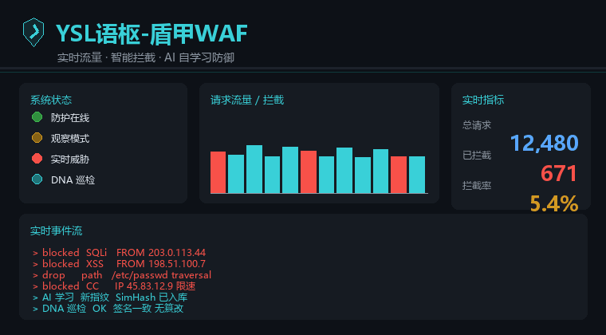

# 功能与运行细节（Features / Operations）

> 本文承接 README 里的细节展开：运行开关、内核与 AI 接线、控制台与大屏、限流熔断、文件 DNA、容器化取舍、完整压测记录。
> 想快速装上就先看 README 的「部署」；想了解设计取舍看 [ARCHITECTURE.md](ARCHITECTURE.md)。

## 1. 运行开关

> v6.3.0 起：下表开关均可在**控制台**实时切换，写入 `var/data/runtime.json`，下一个请求立即生效，无需重启。

| 环境变量 | 默认 | 作用 |
|---|---|---|
| `WAF_MODE=observe` | `enforce` | 只写审计不拦截，上线前观察误报 |
| `WAF_AI_ENABLED=0` | 开 | 退回纯内核快路径，不加载 AI 自学习 |
| `WAF_FP_GUARD=0` | 开 | 关掉叙述性误报复核 |
| `WAF_TAUTOLOGY_GUARD=0` | 开 | 关掉确定性布尔加固 |
| `WAF_BYPASS_GUARD=0` | 开 | 关掉绕过结构加固 |
| `WAF_SEMANTIC_LAYER=1` | 关 | 加载 AST 式语义层（需 `semantic/` 存在） |
| `WAF_LOG_DIR=/dev/shm/waf-logs` | `<站点>/var/logs` | 高频状态写内存盘，**性能提升最大** |
| `WAF_DATA_DIR=...` | `<站点>/var/data` | 控制台密钥目录 |

`WAF_LOG_DIR` 放 tmpfs 时审计日志重启会丢失，需留存请用持久盘；`install.php` 写出的 `.user.ini` 与运行时读同一组变量，自定义目录请在 PHP-FPM 环境设同样的值。

## 2. 内核改了什么

1. **修语义层作用域**：原语义层只在 CLI 自检里生效，HTTP 请求一次没跑；现显式同步，使其真正参与判定。
2. **堵住 403 退化 200**：语义层真跑起来后，未定义键 Warning 提前发出 header 使 `reject()` 的 403 失效；现统一关闭错误输出并修掉两处未定义键。
3. **叙述性误报复核**：自然语言（含中文）且**无任何真实攻击结构**时降级放行，结构黑名单命中保持 403。
4. **布尔恒真式加固**：`id=1 OR 1=1` 类无引号布尔条件确定性补拦，纯内核模式同样生效。
5. **绕过结构加固**：SQL 注释拆分 / JNDI / `php://filter` 等确定语法特征，仲裁前确定性拦截。
6. **PHP 8.1 兼容**：`scoreToRisk()` 显式 `(int)round()`，全仓 0 Fatal / 0 Warning / 0 Deprecated。
7. **参考实现漏放 + 中文误报修复**：补危险协议 / 序列化 / CRLF / LDAP / HPP 等确定性结构，并让中文叙述句走误报复核降级。

## 3. AI 自学习接线

参考实现的 `src/Learn` 与 `src/Semantic` 是完整实现，内核 `YslAiBridge` 的类名本就照这套写，断在四处，现已接通：

| # | 断点 | 处理 |
|---|---|---|
| 1 | `YslAiBridge` 在 `core/` 找带前缀的 `Learning_*.php`，实际无前缀 → 全跳过 | `ai/bootstrap.php` 预加载，类名全部对上 |
| 2 | `checkColdStart()` 读 `total_samples`，参考实现给 `*_count` → 每次判冷启动 | 补别名；训练 30 条后 `cold_start=false` |
| 3 | 语义路径未定义 → 解析器与误报卫士全闲置 | bootstrap 加载 `SemanticEngine` + `WafNormalizer` |
| 4 | 契约不一致（collectAttack / add / get / adjustWeights） | 最小适配，三条样本分流实跑通过 |

接线时另修 3 个运行期缺陷：无限递归撑爆内存、UTF-8 按字节切半字符导致 `bayes_model.json` 写 0 字节、作用域 / Warning 问题。

## 4. 精简模式

去掉 AST 式语义层后，检测由「核心结构规则 + AI 自学习」承担：

- **核心结构规则**（`core/YslEngine.php`，纯 PHP）：`hasHardAttackStructure()`、`hasSqlBooleanTautology()`、污点追踪、证据评分、`YslArbiter` 多票仲裁。
- **AI 自学习**（`ai/`）：贝叶斯、Fisher、指纹、样本采集 / 审核 / 训练 / 权重反哺，全在原始载荷文本上跑，不建语法树。

误报复核改为**纯结构兜底**：无任何攻击结构 + 自然语言（中文同样识别）即降级放行，反而更稳。

## 5. 控制台与态势大屏

**零 JS 控制台** `/waf-console?key=<安装时打印的 key>`：上半部分只读统计（审计事件、拦截分布、AI 信号、运行配置），下半部分原生 POST 表单操作，经密钥 + CSRF 校验后真实执行、结果回显，危险操作用勾选框二次确认。

**态势大屏** `/waf-screen?key=<同一把 key>`：全屏可视化 + 控制台抽屉。

<p align="center">
  
</p>

> 上图为动态效果**示意**（程序化生成，非真实截图）。部署后访问 `/waf-screen?key=<你的key>` 查看真实数据；也可用仓库脚本生成真实截图，见 [SCREENSHOT.md](SCREENSHOT.md)。

- 纯服务端渲染 + 内联 CSS/SVG，原生 JS 仅做 5 秒增量刷新，不引 CDN / 图表库 / 外部字体
- 指标由 `attack.log` 与状态文件真实聚合：流量趋势、决策分布、拦截原因 TOP、攻击类型 TOP、威胁评分直方图、实时审计流、来源 IP 与攻击链、文件 DNA 完整性、加固 / 熔断状态
- `?format=json` 取数、`?static=1` 输出不含密钥的静态快照（禁用控制按钮）
- QPS 面板（当前 QPS + 阈值进度条 + 真实指标 + 分项灯）、DNA 指示灯（呼吸动效，随刷新更新）

> key 鉴权复用 `var/data/console.key`；控制操作经 CSRF + 动作白名单 + 危险二次确认，静态快照不含密钥 / CSRF。

## 6. 控制面与运行时配置

- `var/data/runtime.json`：白名单字段（模式 / 开关 / body 上限 / 白名单），原子写 + 0600
- `shield-waf.php` 每请求读取覆盖配置，文件不存在时与旧版完全等价
- `/waf-control`：唯一写入口，仅 POST + key + 无状态 CSRF + 动作白名单；危险动作需 `confirm=1`；每个动作真实落盘 / 执行后**回读状态**返回
- 操作审计写 `logs/ysl/control.log`，独立于 `attack.log`

动作清单（大屏 44 个控制按钮）：运行配置、熔断与状态、QPS 限流、AI 自学习、审计日志、文件 DNA、访问控制、大屏视图。未做成按钮的旧版函数（webhook 告警、信任 CF IP 等）**未被当前内核调用**，只保留在代码里、不在控制台暴露，避免假功能。

## 7. 蜜罐与全功能控制矩阵

**蜜罐：默认停用，启用过四道闸**

- 触碰诱饵会延迟响应、投喂假数据、把来源标为「确认恶意」；误开会拖慢流量、污染攻击链，故默认关闭
- 启用须同时满足：二次点击确认 + 输入「启用蜜罐」+ 有效期 1~240 分钟 + 用途留痕；少一项不写盘
- 关闭是一键立即生效的安全侧动作；有效期届满自动停用并写审计

**全功能控制矩阵：监控里逐项可见、逐项可点**

- `features.php` 唯一功能注册表：**40 项功能分 5 组**，状态全部取自真实状态文件，**每项都绑定真实存在的动作**，无假按钮
- 大屏主区显示 `40/40 项可控`，每张卡片有状态灯、中文说明、真实按钮与「详细」直达
- 底栏状态灯从「只读指示」改为**可点击**，打开控制台并高亮对应分区；常驻内核能力如实标为「只读 / 可维护」，不冒充开关

## 8. 界面全中文化

只改展示层、不动机器契约：运行模式、熔断状态、原因码、防护开关、响应页、按钮全部中文；状态文件 / `runtime.json` / 控制端点 JSON 的枚举**仍保留英文原值**，外部对接不受影响。刻意保留 WAF / QPS / IP / AI / DNA 等通用缩写与真实文件名（`attack.log`、`runtime.json`），避免运维对不上。

## 9. QPS 限流、熔断与响应页

原内核写了 QPS 降级与 429 页，但滑动窗口是对象实例属性，PHP 每请求重建对象使计数恒为 0/1，**自动熔断从未真实触发**；外壳补齐真实生效的接入层与统一呈现层。

**接入层 `qps.php`**：`flock` + 状态文件，10 个 100ms 桶组成 1 秒滑动窗口（O(1)），全局与单 IP 双维度；软阈值 → 429，硬阈值 → 502 熔断，冷却结束自动半开；默认全局 300/600、单 IP 80/160 QPS，全部控制台实时改；管理路由天然豁免。

**统一响应页 `pages.php`**（零 JS、严格 CSP）：

| 状态码 | 含义 | 内容 |
|---|---|---|
| 403 | 安全规则拦截 | 中文拦截原因、规则标识、威胁评分、风险等级、检测耗时 |
| 429 | QPS 限流 | 当前 QPS、阈值、窗口峰值、触发维度、`Retry-After`、倒计时环 |
| 502 | 保护性熔断 | 电路波形、冷却剩余、自动重试 |
| 503 | 故障关闭 | 内核异常 / 缺失 / **解密扩展未加载**，拒绝带病服务 |
| 413 | 请求体超限 | 提示调上限 |

## 10. 文件 DNA 防篡改（主机层）

请求内检测是网络层第一道；`dna.php` 是**独立 CLI 进程**，负责主机层第二道：站点脚本被插马 / 改配置时，即使请求没触发规则也能发现处置。不在 `auto_prepend_file` 管线，不增加请求耗时。

| 能力 | 实现 |
|---|---|
| 建档 | 递归扫描脚本与配置类文件，排除 uploads/cache/var/logs 等噪音目录；记录 SHA-256、权限、大小、mtime |
| 基线防伪 | HMAC-SHA256 签名，密钥独立存 `.baseline.key`（0600、O_EXCL 创建）；签名不可信时强制只读 |
| 恶意识别 | 高 / 中置信分级 + 递归解码（base64 / gzinflate / rot13 / hex / url）后复扫 |
| 处置铁律 | **仅高置信动手**：精准手术切除 → 术后复扫 → 失败才整体还原；中置信只告警 |
| 新文件 | 落地即扫，高置信后门直接隔离移出站点 |

```bash
php dna.php plan            # 试算范围
php dna.php baseline        # 建档 + 备份 + 签名
php dna.php scan            # 巡检（只读告警）
php dna.php scan --apply    # 处置高置信篡改
php dna.php watch --interval=30 --apply   # 轮询守护
```

默认只读，`--apply` 才处置；PHP 版无 inotify，用轮询守护兜底，实时性弱于事件驱动（如实标注的边界）。

## 11. 为什么 PHP 版不提供 Docker 镜像

常被问「旧版有 docker-compose，新版怎么没了」。这不是能力退化，是那条路本来就护不住站点：

- **本版是进程内嵌型**：通过 `auto_prepend_file` 挂进站点自己的 PHP-FPM，每个请求先过内核再进业务代码。它是一段运行在业务进程里的代码，**不是网关**。
- **独立容器碰不到流量**：给 WAF 单开一个容器，只有打向该容器的请求才会经过它；客户真实站点在别处，请求根本不从这儿走。旧版那份 `docker-compose.yml` 本质是「nginx + php + WAF 的演示环境」（映射 `8080:80`），对真实站点没有防护作用。
- **正确的容器化姿势**：把本仓库 COPY 进**业务镜像**（站点目录之外），构建期写入站点 `.user.ini` 的 `auto_prepend_file`。WAF 跟着业务进程一起跑，而不是单开一个容器。
- **需要独立进程形态时**：那是反向代理，由商业版（Go 内核，监听入口 → 源站）承担，Docker 离线包在官网下载页提供，`docker load -i` 即起。

一句话：**PHP 版是库，装进业务进程才生效；只有反向代理才谈得上容器化交付。**

## 12. 性能与压测明细

**修复后实测（Docker `php:8.1-cli` / 8 worker，完整口径见 `docs/EXTREME.md`）**

| 场景 | 吞吐 | P50 | P95 |
|---|---|---|---|
| 正常请求（单并发） | — | 3.9 ms | 4.3 ms |
| 并发 16 / 32 / 64 | 1170 / 1250 / 1243 req/s | 12.9 / 23.5 / 46.1 ms | 19.8 / 34.6 / 68.0 ms |
| 20s 长稳（并发 32） | 1160 req/s | 23.2 ms | 41.0 ms |

**旧版 Windows bind mount 的历史数据（修复前，仅作参考）**

| 配置 | p50 | 相对默认 |
|---|---|---|
| 默认 `var/logs`（最差情形） | 323 ms | — |
| `WAF_LOG_DIR=/dev/shm/waf-logs` | 52 ms | −84% |
| tmpfs + `WAF_AI_ENABLED=0` | 29 ms | −91% |

当时把差距归因为「磁盘 IO 是主要开销」，后续定位证伪：真正瓶颈是 `YslAudit::flush()`
每请求全量重扫历史日志取哈希链末端（O(n²)），磁盘快慢只是叠加因素；已在代码层修复
（`docs/EXTREME.md` 第四节第 5 项）。把 `WAF_LOG_DIR` 指向 tmpfs 仍能进一步降低落盘
开销，但不再是必需项；生产 Linux + PHP-FPM + OPcache 仍优于旧表 bind mount 数字。

**与旧版的横向对比（自制小样本）**

| 类别 | 旧版 | 本版 |
|---|---|---|
| 正常 / 叙述性文本（6 条） | 4 条 403（误报） | 6 条 200 |
| 常见注入 / XSS / 穿越（7 条） | 全 403 | 全 403 |
| 绕过载荷 | 全 403 | 修前漏 3 条，v6.0.1 后全 403 |

结论：本版**误报**明确优于旧版、**本组检出**打平；不外推为整体更强。旧版还带自动封禁、蜜罐、CC 防护等本版精简掉的功能面。

**Docker 压测（346 请求/轮 × 冷/热态）**

| 实例 | recall | fpr | p50 |
|---|---|---|---|
| A 完整 AI（冷/热） | **100%** | **0%** | 172 ms |
| B 纯内核 | 99.3% | 18.89% | ~155 ms |
| C 旧版（冷） | 75.35% | 7.22% | 684 ms |

完整 AI 相对旧版：检出 100% vs 75.35%、误报 0% vs 7.22%、延迟 172 ms vs 684 ms。纯内核是「不要 AI 只要快」的取舍（fpr 18.89%），生产默认走 A。

**精简复核（78 条端到端）**：扩展压测先揪出 2 个真 bug（中文叙述被 AI 推高误拦且抖动、`....//....//boot.ini` 点填充穿越漏放），修复后 **clean 与 AI 被污染两态均 0 误报 / 0 漏放**；体积从 2.59 MiB / 72 文件降至 **0.94 MiB / 35 文件**，运行期不再加载语义层。

**验证记录（Docker + PHP 8.1 / 8.5，全部实跑）**

| 项 | 结果 |
|---|---|
| 语法 | 全仓 PHP `php -l`，8.1 / 8.5 均 0 错误 |
| AI 接线自检 | `tests/ai_check.php` 全过：12 个 AI 类加载、30 条训练、贝叶斯 1.000 vs 0.000、走出冷启动 |
| 误报 + 攻击回归 | `tests/fp_regression.sh` **37/37**：9 条正常 200、28 条攻击 403（含无引号布尔、注释拆分 / JNDI / `php://filter`、SSRF / 序列化 / CRLF / LDAP / HPP） |
| 开关验证 | 多配置各 6 用例，0 Fatal / 0 Warning / 0 Deprecated |
| 源码模式 | 正常 200、攻击 403、控制台无 key 403 / 有 key 200 |
| 观察模式 | 注入 200 且业务继续执行，审计照常 |
| 强制拦截 | 注入返回 **403 美化页**（严格 CSP + 真实规则标识），业务未执行 |
| 故障关闭 | 内核异常 → **503 美化页**；缺解密扩展 → **503 美化页（明示原因）** |
| 安装 | `--check` / 安装 / 重复去重 / 卸载还原 全过；缺扩展时中止不写配置 |
| 控制台端到端 | `tests/control_check.php` **70/70** |
| 蜜罐受控 | `tests/honeypot_check.php` **32/32** |
| 控制矩阵 | `tests/feature_matrix_check.php` **37/37**：40/40 项可控、无假按钮 |
| 极限对抗 | 2376 条回放 **全部拦截 / 0 漏放**（含 base64 大小写混淆变体） |
| 中文化 | `tests/i18n_check.php` **31/31** |
| QPS 与响应页 | `tests/qps_check.php` **55/55** |
| 精简压测 | 78 条 clean / 污染两态均 0/0；phar 0 Fatal / 0 Warning / 0 Deprecated |
| Docker 压测 | 完整 AI 召回 100% / 误报 0% / p50 172 ms |
